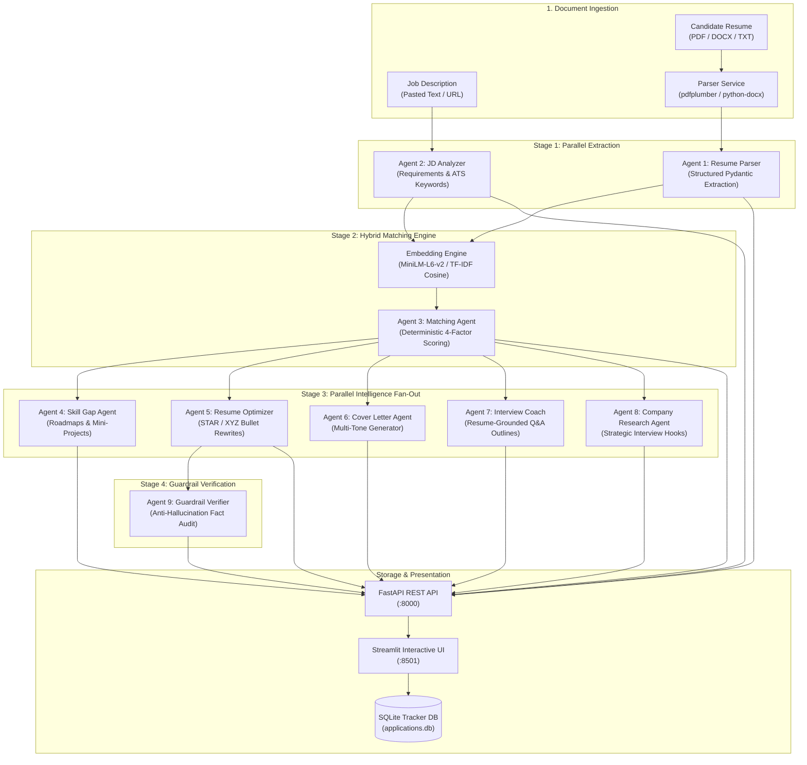

# AI Job Application Intelligence Agent

[](https://www.python.org/downloads/)
[](https://fastapi.tiangolo.com)
[](https://streamlit.io)
[](https://docs.pydantic.dev/)
[](https://docs.pytest.org/)
[](https://opensource.org/licenses/MIT)

A production-grade, multi-agent AI system designed to eliminate the guesswork from technical job applications. Built with **FastAPI**, **Streamlit**, **Google Gemini**, and **Pydantic v2**, the system evaluates resume-job alignment, calculates a transparent 4-factor match score, identifies skill gaps with concrete project blueprints, generates truthful STAR/XYZ bullet rewrites with strict anti-hallucination guardrails, crafts tailored cover letters, and manages candidates' applications via an integrated SQLite tracker.

---

## 📌 Problem Statement

Applying to competitive software and AI roles presents three fundamental challenges:

1. **The ATS Black Box**: Candidates submit resumes without knowing whether their skills and keyword density meet automated screening thresholds.
2. **The Hallucination Trap of Generative AI**: Generic LLMs frequently fabricate previous employers, invent unverified quantitative metrics (e.g., claiming "cut latency by 45%" when the candidate only built an API), and produce hollow, cliché-ridden cover letters.
3. **Vague Upskilling Advice**: Candidates with skill gaps are routinely told to "learn Kubernetes" or "study system design" without structured, portfolio-ready project roadmaps.

The **AI Job Application Intelligence Agent** solves these problems with deterministic scoring, a strict negative-constraint guardrail engine that verifies generated statements against source resumes, and single-responsibility agent specialization.

---

## 🏗️ Architecture & Multi-Agent DAG

The platform executes a Directed Acyclic Graph (DAG) orchestrator where independent parsing, intelligence synthesis, and verification stages run concurrently.



---

## 🔬 Core Features & Agent Roles

| Agent / Module | Responsibility | Output Schema |
| :--- | :--- | :--- |
| **Agent 1: Resume Parser** | Ingests PDF, DOCX, or text; extracts structured skills, work history, projects, and credentials. | `ParsedResume` |
| **Agent 2: JD Analyzer** | Parses required vs. preferred qualifications, responsibilities, seniority tier, and ATS keywords. | `ParsedJD` |
| **Agent 3: Matching Engine** | Computes multi-factor deterministic score ($0 - 100$) combining semantic similarity, keyword overlap, and seniority. | `MatchScoreBreakdown` |
| **Agent 4: Skill Gap Agent** | Classifies skills as *Matched*, *Partial*, or *Missing*; designs actionable weekend portfolio projects. | `SkillGapReport` |
| **Agent 5: Resume Optimizer** | Rewrites accomplishment bullets into STAR or Google XYZ impact statements with target ATS keywords. | `ResumeOptimizationReport` |
| **Agent 6: Cover Letter Agent** | Crafts non-generic, high-converting cover letters with configurable tone (`confident`, `formal`, `friendly`). | `CoverLetterResponse` |
| **Agent 7: Interview Coach** | Curates role-specific technical and behavioral questions with STAR outlines grounded in candidate projects. | `InterviewPrepReport` |
| **Agent 8: Research Agent** | Synthesizes company mission, engineering culture, recent strategic priorities, and interview hooks. | `CompanyResearchReport` |
| **Agent 9: Guardrail Verifier** | Audits generated text against original resume entities and metrics; flags unverified numbers. | `GuardrailVerificationResult` |
| **Application Tracker** | SQLite-backed lifecycle tracker (Wishlist $\rightarrow$ Applied $\rightarrow$ Interviewing $\rightarrow$ Offer $\rightarrow$ Rejected) with CSV export. | `ApplicationRecord` |

---

## 📐 Scoring Formula & Guardrails

### 1. Transparent 4-Factor Scoring
The composite match score ($0 - 100$) is computed through a weighted formula:

$$\text{Overall Score} = 0.40 \cdot \text{Skills} + 0.30 \cdot \text{Experience} + 0.20 \cdot \text{Keywords} + 0.10 \cdot \text{Education}$$

- **Skills Fit (40%)**: Ratio of matched core requirements ($1.0$ weight) and preferred skills ($0.25$ weight) using cosine semantic similarity.
- **Experience Fit (30%)**: Verified total professional years vs. minimum requirement ($70\%$ weight) combined with responsibility semantic alignment ($30\%$ weight).
- **ATS Keyword Overlap (20%)**: Normalized exact and lemma boundary matches of target ATS terms.
- **Education Fit (10%)**: Degree level prerequisites (B.S., M.S., Ph.D.) and accredited certifications.

### 2. Anti-Hallucination Guardrail Engine
To guarantee candidates never misrepresent facts:
- Prompts enforce strict negative constraints: *"Never invent employers, job titles, university degrees, or unperformed projects."*
- A secondary audit engine regex-extracts quantitative metrics (e.g. `$18K`, `358%`, `55 req/s`) from both the original and rewritten bullets.
- Any newly suggested impact metric absent from the original resume is explicitly tagged with `requires_confirmation=True` and a prominent notice: `[Verify metric: X% improvement]`.

---

## 🚀 Quickstart & Installation

### Prerequisites
- Python 3.11+
- Git

### 1. Clone & Set Up Virtual Environment
```bash
git clone https://github.com/your-username/job-intel-agent.git
cd job-intel-agent

# Create virtual environment
python -m venv venv
# On Windows:
.\venv\Scripts\activate
# On Linux/macOS:
source venv/bin/activate

# Install dependencies
pip install -r requirements.txt
```

### 2. Configure Environment Variables
Copy the template configuration file:
```bash
cp .env.example .env
```
Edit `.env` to configure your Gemini API Key (optional—agent runs an intelligent offline mode if omitted):
```env
GEMINI_API_KEY=your_gemini_api_key_here
GEMINI_MODEL=gemini-1.5-flash
LLM_PROVIDER=gemini
DATABASE_PATH=data/applications.db
ENABLE_LLM_CACHE=True
CACHE_DIR=data/cache
API_HOST=127.0.0.1
API_PORT=8000
```

### 3. Run the Streamlit Dashboard
```bash
streamlit run app/ui/main.py
```
Open [http://localhost:8501](http://localhost:8501) in your browser.

### 4. (Optional) Run the FastAPI REST Backend
```bash
uvicorn app.api.main:app --host 127.0.0.1 --port 8000 --reload
```
Interactive Swagger documentation is available at [http://127.0.0.1:8000/docs](http://127.0.0.1:8000/docs).

---

## 🧪 Testing & Evaluation Harness

### Run Automated Unit Tests (30 Tests)
```bash
pytest tests/ -v
```
Output:
```
============================== 30 passed in 3.30s ==============================
```

### Run Evaluation Suite (5 Benchmark Pairs + 1 Negative Control)
```bash
python evals/run_evals.py
```
Output:
```
================================================================================
🚀 STARTING AI JOB APPLICATION INTELLIGENCE AGENT EVALUATION HARNESS
================================================================================
✅ [eval-1] Senior ML Engineer (Domain Match)             | Score:  95.4/100 | Tier: Strong Match   | Latency: 0.03s
✅ [eval-2] Full Stack React/Python (Domain Match)        | Score:  92.2/100 | Tier: Strong Match   | Latency: 0.02s
✅ [eval-3] Lead Data Analyst (Domain Match)              | Score:  85.4/100 | Tier: Strong Match   | Latency: 0.03s
✅ [eval-4] Cloud DevOps & SRE (Domain Match)             | Score:  85.4/100 | Tier: Strong Match   | Latency: 0.03s
✅ [eval-5] Junior Backend Developer (Domain Match)       | Score:  95.4/100 | Tier: Strong Match   | Latency: 0.02s
✅ [eval-6-negative] Negative Control: Junior vs Senior ML| Score:  43.3/100 | Tier: Weak Match     | Latency: 0.09s
--------------------------------------------------------------------------------
📊 SUMMARY: Total Benchmarks: 6 | Pass Rate: 100.0% | Avg Latency: 0.04s
================================================================================
```

---

## 📸 Screenshots & UI Walkthrough

| Executive Score Dashboard | Skill-Gap & Project Blueprints |
| :---: | :---: |
| *Visual score gauge with multi-factor breakdown and reasoning.* | *Matched/partial/missing badges with weekend mini-projects.* |

| Truthful STAR Bullet Optimizer | Application Lifecycle Tracker |
| :---: | :---: |
| *Side-by-side comparison with audit guardrails.* | *SQLite database table with stage management and CSV export.* |

---

## ⚖️ Engineering Decisions & Trade-Offs

| Decision | Why Chosen | Trade-Off |
| :--- | :--- | :--- |
| **Custom DAG Orchestrator vs. LangGraph** | Chosen for transparency, lightweight zero-overhead async parallel execution, and zero unnecessary framework lock-in. | Requires manual handling of state pass-through rather than relying on high-level graph abstractions. |
| **Hybrid Embeddings (sentence-transformers + TF-IDF fallback)** | Guarantees the application runs instantly on lightweight or offline systems without failing if PyTorch or Hugging Face models are downloading. | TF-IDF has lower semantic nuance on extreme paraphrasing than deep neural bi-encoders. |
| **Pydantic v2 Schema Enforcement** | Enforces runtime type validation and JSON schema generation for structured LLM parsing with auto-retry. | Requires strict schema maintenance as prompt requirements evolve. |
| **SHA-256 Response Caching** | Prevents duplicate LLM API calls on identical prompt inputs, dramatically reducing latency and API costs. | Requires cache invalidation strategy when switching prompt templates or models. |

---

## 🔮 Limitations & Future Work

- **Multi-Page Layout Retention**: Future releases will export optimized bullets directly back into native DOCX/PDF templates preserving existing typography.
- **Chrome Extension Companion**: Developing a lightweight browser extension to parse LinkedIn and Indeed postings directly into the agent with one click.
- **Fine-Tuned Guardrail Model**: Training a specialized small language model (SLM) for sub-millisecond local entity verification.

---

## 📄 License
This project is licensed under the MIT License — see the [LICENSE](LICENSE) file for details.
